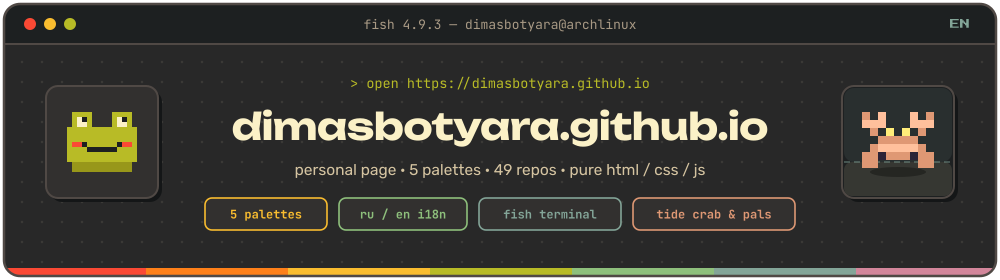
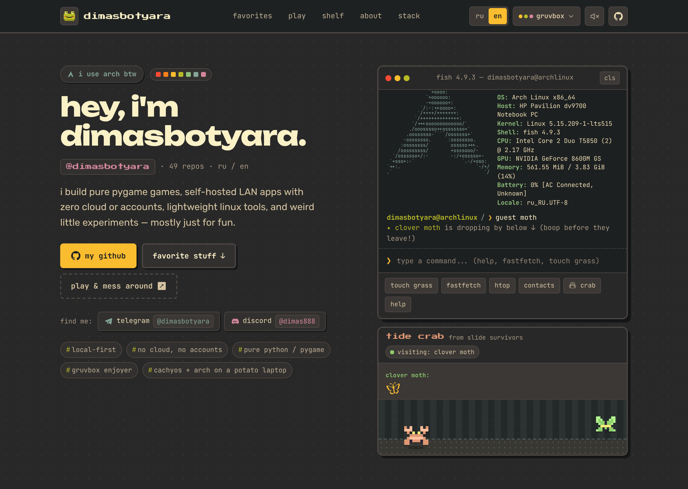
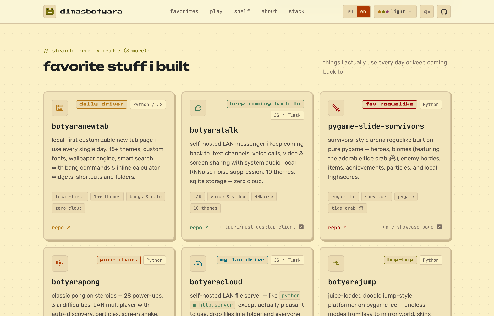
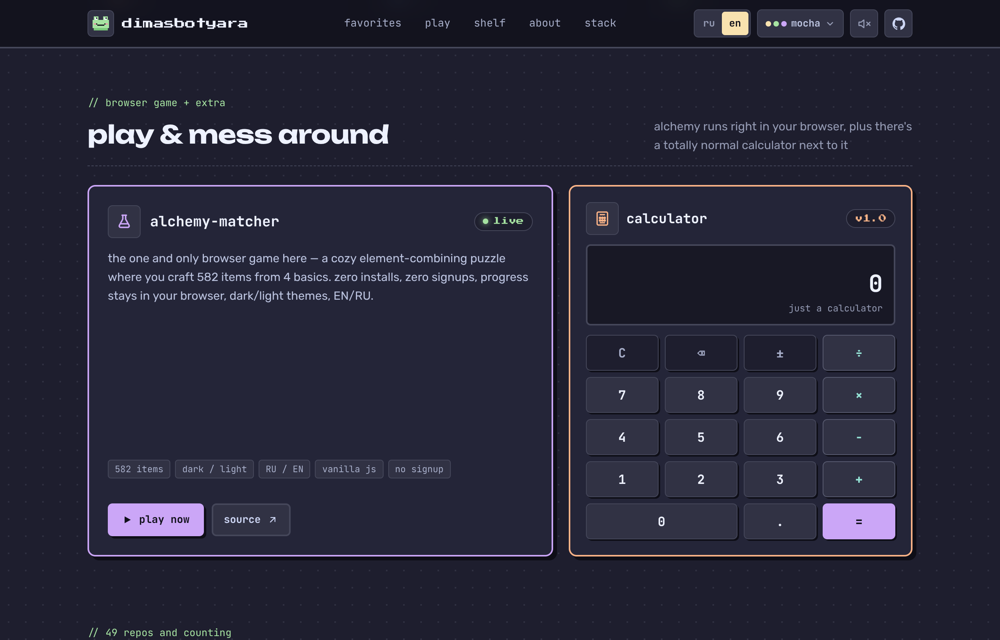

<p align="center">
  <a href="https://dimasbotyara.github.io/">
    
  </a>
</p>

<p align="center">
  <strong>🇬🇧 English</strong> · <a href="README.ru.md">🇷🇺 Русский</a>
</p>

<p align="center">
  🌐 <strong>Live site:</strong> <a href="https://dimasbotyara.github.io/">dimasbotyara.github.io</a>
</p>

---

## 👋 what is this?

My personal GitHub Pages homepage — built with plain **HTML, CSS, and vanilla JS** (zero bundlers, zero frameworks, zero trackers). Just a cozy Gruvbox corner on the internet with my projects, an interactive terminal, and a tiny pixel crab wandering around. 🐸🦀

## ✨ what's inside

- 🎨 **5 color palettes** — **Gruvbox Dark** (default), **Gruvbox Light**, **Catppuccin Mocha**, **Ayu Mirage**, and **Nord**. Pick from the unified ⚙ settings menu, press `T`, or switch right in the terminal (`theme catppuccin`, `theme ayu`, `theme nord`, `theme list`).
- 🌍 **Bilingual RU / EN** — auto-detects your browser locale (`navigator.languages`), supports `?lang=en` / `?lang=ru`, plus a manual switcher.
- 🔤 **5 distinct fonts** — `Unbounded` (headings), `Press Start 2P` (pixel accents across both Latin & Cyrillic), `JetBrains Mono` (terminal & code), `Rubik` (body), and `Caveat` (handwritten notes).
- 🔊 **Gentle micro-SFX** — pure Web Audio API soft sounds (muted by default, toggle via the ⚙ settings menu or `sound` in the terminal — zero audio files).
- ⚙️ **Unified settings menu** — one cozy overlay for palette, micro-sounds and language keeps the topbar slim and phone-friendly — on phones the section links live in a compact ☰ menu overlay (no horizontal scroll).
- 💻 **Interactive `fish 4.9.3` terminal** — starts with `touch grass` & `fastfetch` from my old HP Pavilion dv9700, supports `25+` commands (`help`, `htop`, `battery`, `pacman -Syu`, `cowsay`, `frogsay`, `matrix`, `fortune`, `crab`, `wildlife`, `guest`, `contacts`, `theme`, `sound`, `lang`, and more) with ↑/↓ history.
- 🦀 **Tide Crab & visiting pixel wildlife** — exact pixel sprites, RGB palettes, and 4-frame wing/leg animations straight from [`pygame-slide-survivors/wildlife.py`](https://github.com/dimasbotyara/pygame-slide-survivors). Tide Crab lives on the coast (44 quotes!), while **Clover Moth**, **Echo Bat**, **Rune Wisp**, **Reed Toad**, and **Cinder Slug** periodically drop by — click any visitor to pause and chat with them, or leave them alone for 20s and they'll head off on their way 🦋🦇🐸.
- ⭐ **All 51 repositories** — 6 favorites at the top, [`alchemy-matcher`](https://dimasbotyara.github.io/alchemy-matcher/) playable right in the browser, and a filterable/searchable shelf with a **random repo roller** 🎲.
- 🧮 **Retro calculator** — just a totally normal calculator sitting next to the browser game. Nothing suspicious here at all 🤭.
- 📱 **Responsive & share-ready** — tuned for phones, tablets, and desktops, with one-click copy for Telegram (`@dimasbotyara`) and Discord (`@dimas888`), plus a crisp Open Graph preview card (`assets/og-card.png`).

## 📸 screenshots

### Gruvbox Dark — Hero, Terminal, Tide Crab & Visiting Clover Moth


### Gruvbox Light — Favorite Projects


### Catppuccin Mocha — Browser Game & Retro Calculator


## ⌨️ keyboard shortcuts

| Key | Action |
| --- | --- |
| `T` | Cycle color palettes |
| `L` | Switch language (`EN` / `RU`) |
| `/` | Jump to project shelf search |

*(Shortcuts also work on Russian keyboard layout: `Е` / `Д`!)*

## 🚀 run locally

No `npm install`, no build step — serve it with anything:

```bash
git clone https://github.com/dimasbotyara/dimasbotyara.github.io.git
cd dimasbotyara.github.io
python3 -m http.server 8080
```

Then open `http://localhost:8080`.

## 📁 files

```text
.
├── index.html       # layout & anti-FOUC theme/locale bootstrap
├── styles.css       # Gruvbox Dark/Light themes, 5-font typography & responsive rules
├── data.js          # RU/EN copy, Tide Crab pixels, all 51 repos & fastfetch data
├── app.js           # i18n, themes, terminal, Tide Crab AI, calculator & filters
├── favicon.svg      # pixel Gruvbox frog icon
├── assets/          # EN & RU README SVG banners + Open Graph card (og-card.png)
├── screenshots/     # EN & RU screenshots
├── README.md        # this file (English)
└── README.ru.md     # Russian README
```

---

<p align="center">
  made with 💜 and gruvbox by <a href="https://github.com/dimasbotyara">dimasbotyara</a> 🐸
</p>
