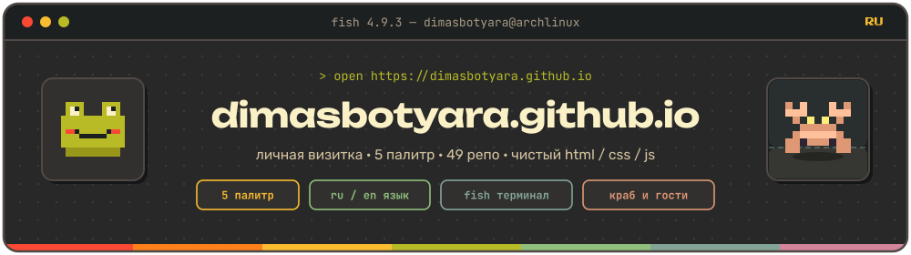
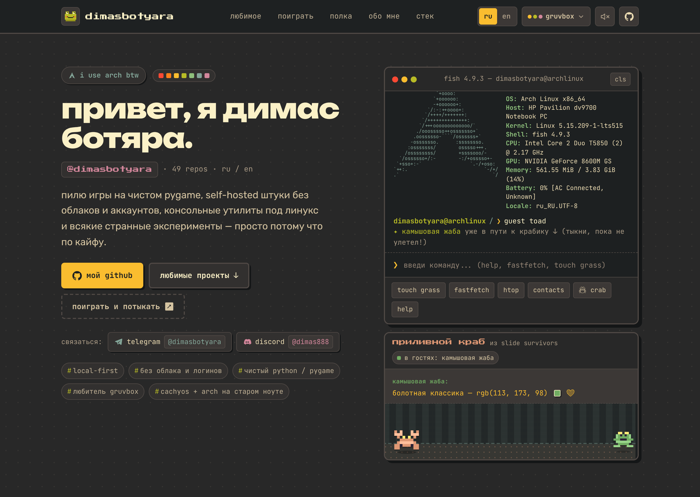
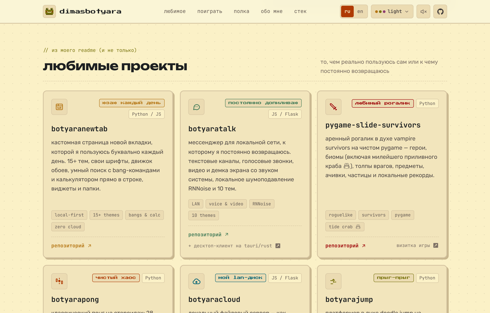
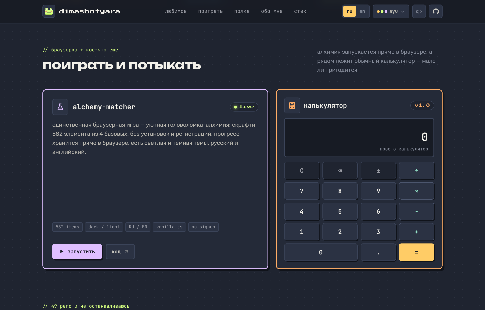

<p align="center">
  <a href="https://dimasbotyara.github.io/">
    
  </a>
</p>

<p align="center">
  <a href="README.md">🇬🇧 English</a> · <strong>🇷🇺 Русский</strong>
</p>

<p align="center">
  🌐 <strong>Живой сайт:</strong> <a href="https://dimasbotyara.github.io/">dimasbotyara.github.io</a>
</p>

---

## 👋 что это?

Моя личная визитка на GitHub Pages — на чистых **HTML, CSS и ванильном JS** (без сборщиков, фреймворков и трекеров). Просто уютный уголок в палитре Gruvbox со всеми моими проектами, интерактивным терминалом и пиксельным крабиком, который гуляет по берегу. 🐸🦀

## ✨ что внутри

- 🎨 **5 цветовых палитр** — **Gruvbox Dark** (по умолчанию), **Gruvbox Light**, **Catppuccin Mocha**, **Ayu Mirage** и **Nord**. Переключаются через видимый пикер в шапке, клавишей `T` или прямо из терминала (`theme catppuccin`, `theme ayu`, `theme nord`, `theme list`).
- 🌍 **Два языка (RU / EN)** — сам определяет локаль браузера (`navigator.languages`), понимает `?lang=ru` / `?lang=en` и даёт переключить вручную в один клик.
- 🔤 **5 разных шрифтов** — `Unbounded` (заголовки), `Press Start 2P` (пиксельные акценты одинаково для кириллицы и латиницы), `JetBrains Mono` (терминал и код), `Rubik` (основной текст) и `Caveat` (рукописные пометки).
- 🔊 **Тихие микро-звуки** — мягкий процедурный Web Audio синтез без единого аудиофайла (выключен по умолчанию, включается кнопкой в шапке или командой `sound`).
- 💻 **Интерактивный терминал `fish 4.9.3`** — встречает легендарным `touch grass` и `fastfetch` со старого HP Pavilion dv9700, знает `25+` команд (`help`, `htop`, `battery`, `pacman -Syu`, `cowsay`, `frogsay`, `matrix`, `fortune`, `crab`, `wildlife`, `guest`, `contacts`, `theme`, `sound`, `lang` и другие) и помнит историю по ↑/↓.
- 🦀 **Приливной краб и заглядывающие жители** — точные пиксельные спрайты, палитры и 4-кадровые анимации крыльев/лапок прямо из [`pygame-slide-survivors/wildlife.py`](https://github.com/dimasbotyara/pygame-slide-survivors). Краб живёт на берегу (44 фразы!), а в гости залетают и заглядывают **Клеверный мотылёк**, **Гулкая мышь**, **Рунный огонёк**, **Камышовая жаба** и **Шлаковый слизень** — кликай по любому, чтобы он остановился и поболтал, а если не трогать 20 секунд — полетит дальше по своим делам 🦋🦇🐸.
- ⭐ **Все 51 репозиторий** — 6 любимых наверху, браузерная игра [`alchemy-matcher`](https://dimasbotyara.github.io/alchemy-matcher/) и полка со всеми остальными проектами, фильтрами, поиском и кнопкой **«рандомный репо»** 🎲.
- 🧮 **Ретро-калькулятор** — абсолютно обычный калькулятор рядом с игрой. Никаких подвохов, честно 🤭.
- 📱 **Адаптив и OG-превью** — аккуратно работает на телефонах, планшетах и десктопах, Telegram (`@dimasbotyara`) и Discord (`@dimas888`) копируются в один тап, а при отправке ссылки в мессенджеры красиво раскрывается `assets/og-card.png`.

## 📸 скриншоты

### Gruvbox Dark — первый экран, терминал, краб и Камышовая жаба


### Gruvbox Light — любимые проекты


### Ayu Mirage — браузерная игра и ретро-калькулятор


## ⌨️ горячие клавиши

| Клавиша | Действие |
| --- | --- |
| `T` / `Е` | Переключить следующую палитру |
| `L` / `Д` | Переключить язык (`RU` / `EN`) |
| `/` | Перейти к поиску по полке проектов |

## 🚀 локальный запуск

Никаких `npm install` и сборок — просто подними любой статический сервер:

```bash
git clone https://github.com/dimasbotyara/dimasbotyara.github.io.git
cd dimasbotyara.github.io
python3 -m http.server 8080
```

И открой `http://localhost:8080`.

## 📁 структура

```text
.
├── index.html       # разметка и ранняя инициализация темы и языка
├── styles.css       # темы Gruvbox Dark/Light, 5 шрифтов и адаптив
├── data.js          # тексты RU/EN, пиксели Приливного краба, все 51 репо и fastfetch
├── app.js           # локализация, темы, терминал, краб, калькулятор и фильтры
├── favicon.svg      # пиксельная лягуха в Gruvbox
├── assets/          # SVG-баннеры для README (EN и RU) + OG-карточка (og-card.png)
├── screenshots/     # скриншоты сайта (EN и RU)
├── README.md        # README на английском
└── README.ru.md     # этот файл (на русском)
```

---

<p align="center">
  сделано с 💜 и любовью к gruvbox — <a href="https://github.com/dimasbotyara">dimasbotyara</a> 🐸
</p>
